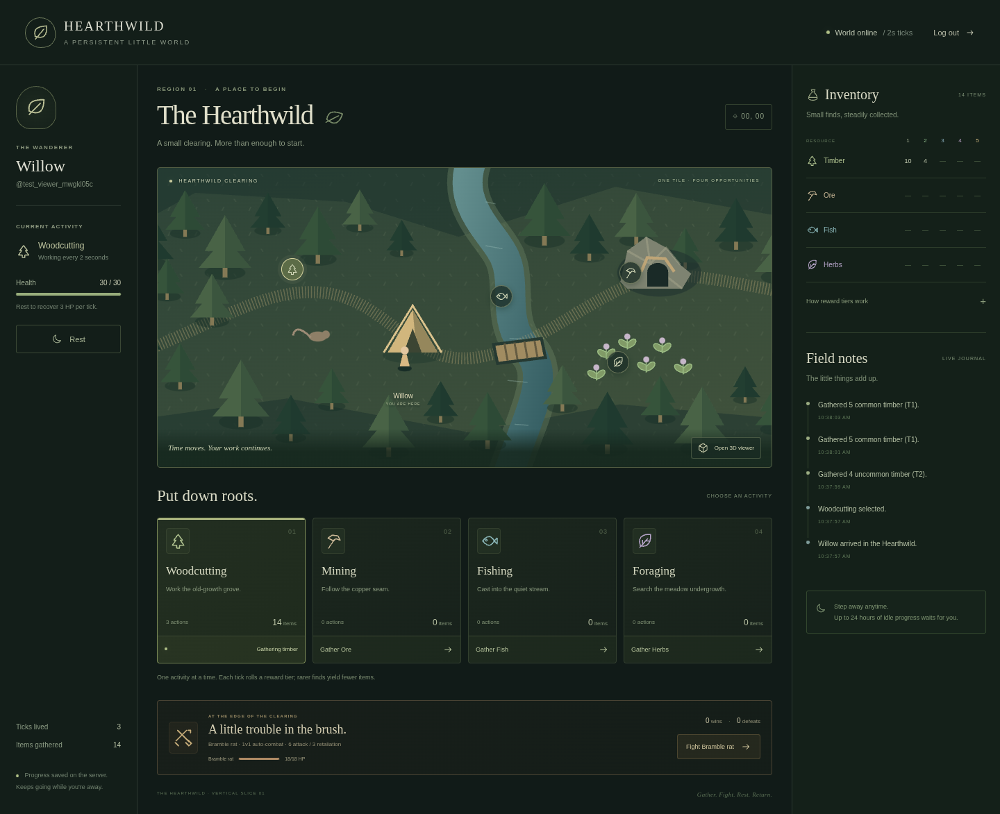
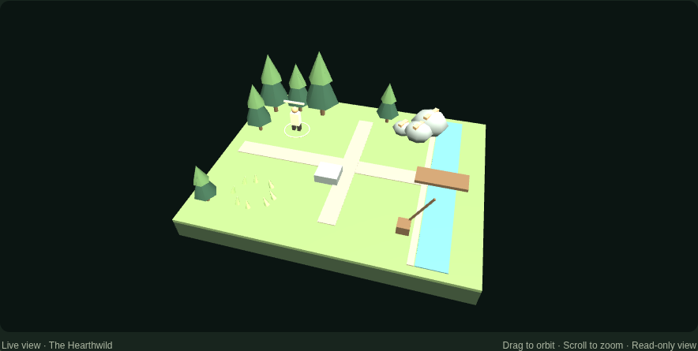

# Working demonstration

Captured from the production build in Chromium on November 14, 2026. These are screenshots of a real account and live server snapshots, produced by the passing browser suite.



## Try it

With Node.js 24+:

```sh
npm ci
npm run build
npm start
```

Open http://localhost:3001, create an account and character, then choose any gathering skill. Inventory updates on two-second server ticks. Switch to combat to watch a rat fight automatically, or rest to recover. Reload or return after logging out to resume the same character. Open the 3D viewer to inspect the current activity without changing the simulation.

## Optional Babylon viewer



The viewer is closed by default. It only receives character snapshots, renders local geometry and updates positions and health bars. It makes no API calls and cannot grant rewards or run combat. The browser suite also disables WebGL and verifies gathering still works.

[See the mobile capture](mobile.png).

## Verified result

`npm run check` completed successfully:

- TypeScript: passed.
- Server integration: **10 passed, 0 failed**.
- Production build: passed.
- Chromium browser scenarios: **3 passed, 0 failed**.

Integration coverage includes authentication and private sessions, account isolation, all four skills and all five reward tiers, deterministic reward frequencies, tick boundaries, exact restart/RNG persistence, offline limits, single-target combat and recovery, rejected client clocks/rewards, session expiry, and background progress with no connected client.

Browser coverage includes account creation through returning login, all four gathering actions, inventory persistence after reload, a combat victory, progress while the page is absent, the actual Babylon canvas, missing-WebGL fallback, and desktop/mobile overflow checks. Images are captured in the browser test outputs; these copies document the verified run.

There are no unresolved test failures. The build emits a size warning for the optional Babylon chunk (approximately 1.13 MB before gzip, 278 KB gzip); core gameplay loads separately. This is a local Node/SQLite demonstration; public hosting is not provisioned. Catch-up after server downtime is limited to the latest 24 hours per reconciliation.
